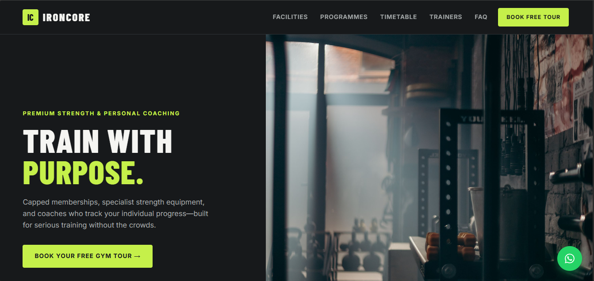

# IRONCORE FITNESS — Boutique Strength & Personal Coaching Website

A high-contrast, conversion-focused single-page website for **IRONCORE FITNESS**, a boutique strength training and personal coaching studio in Downtown Austin, TX. Built with semantic HTML5, modern CSS3, and Vanilla JavaScript—designed to drive **Free Gym Tour** bookings with fast load times and zero framework overhead.

🔗 **Live Demo:** [https://tarunkanojia98.github.io/ironcore-fitness/](https://tarunkanojia98.github.io/ironcore-fitness/)



## ✨ Key Features

- **Dark-First Design System:** Deep charcoal surfaces (`#17191B`) paired with high-energy acid lime accents (`#C5F04A`) and bold *Barlow Condensed* + *Inter* typography.
- **45/55 Split Hero & Value Strip:** Asymmetric desktop hero locking into an above-the-fold layout with a 3-pillar value strip underneath.
- **Conversion-Focused 4-Step Tour Booking:** Structured tour breakdown paired with a serverless enquiry form powered by [Web3Forms](https://web3forms.com/), complete with hidden honeypot spam protection (`botcheck`) and a Demo Mode fallback.
- **Interactive UI Components:** Accessible FAQ accordion, responsive weekly group training timetable, mobile navigation drawer, and floating WhatsApp quick-chat button.
- **Dark-Themed Location Embed:** Full-width Google Maps embed for Downtown Austin styled to blend seamlessly into the dark charcoal palette.
- **Local SEO & Social Sharing Ready:** Configured with OpenGraph tags, Twitter/X Cards, an inline SVG monogram favicon (`IC`), and `HealthClub` JSON-LD structured data.
- **Centralized Configuration:** Contact details, WhatsApp routing, map embed URL, and Web3Forms API key are managed via `SITE_CONFIG` in `script.js`.

## 🛠️ Tech Stack

- **HTML5** — Semantic markup, accessible controls, and JSON-LD schema
- **CSS3** — Custom properties (`:root`), CSS Grid, Flexbox, and responsive breakpoints
- **Vanilla JavaScript (ES6+)** — FAQ accordion, mobile nav toggle, dynamic config injection, and Fetch API form submission
- **Web3Forms** — Serverless lead capture backend

## 📂 Project Structure

```text
ironcore-fitness/
├── index.html      # Page structure, SEO metadata, and HealthClub JSON-LD
├── styles.css      # Dark-first design tokens, layout grids, and responsive rules
├── script.js       # SITE_CONFIG, FAQ accordion, WhatsApp/Map setup, and form handler
├── images/         # Hero, facility, trainer photography, and preview screenshot
└── README.md
```

## 🚀 Running Locally

1. Clone the repository:
   ```bash
   git clone [https://github.com/tarunkanojia98/ironcore-fitness.git](https://github.com/tarunkanojia98/ironcore-fitness.git)
   ```
2. Open `index.html` directly in your browser.
3. *(Optional)* Add your free access key from [Web3Forms](https://web3forms.com/) to `web3FormsAccessKey` in `script.js` to enable live email delivery.

## 👤 Author

**Tarun Kanojia**
- GitHub: [@tarunkanojia98](https://github.com/tarunkanojia98)
- LinkedIn: [Your LinkedIn Profile](https://www.linkedin.com/in/tarun-kanojia-a08458188/)

---

*Note: IRONCORE FITNESS is a fictional boutique gym brand created as a front-end design and development portfolio project.*